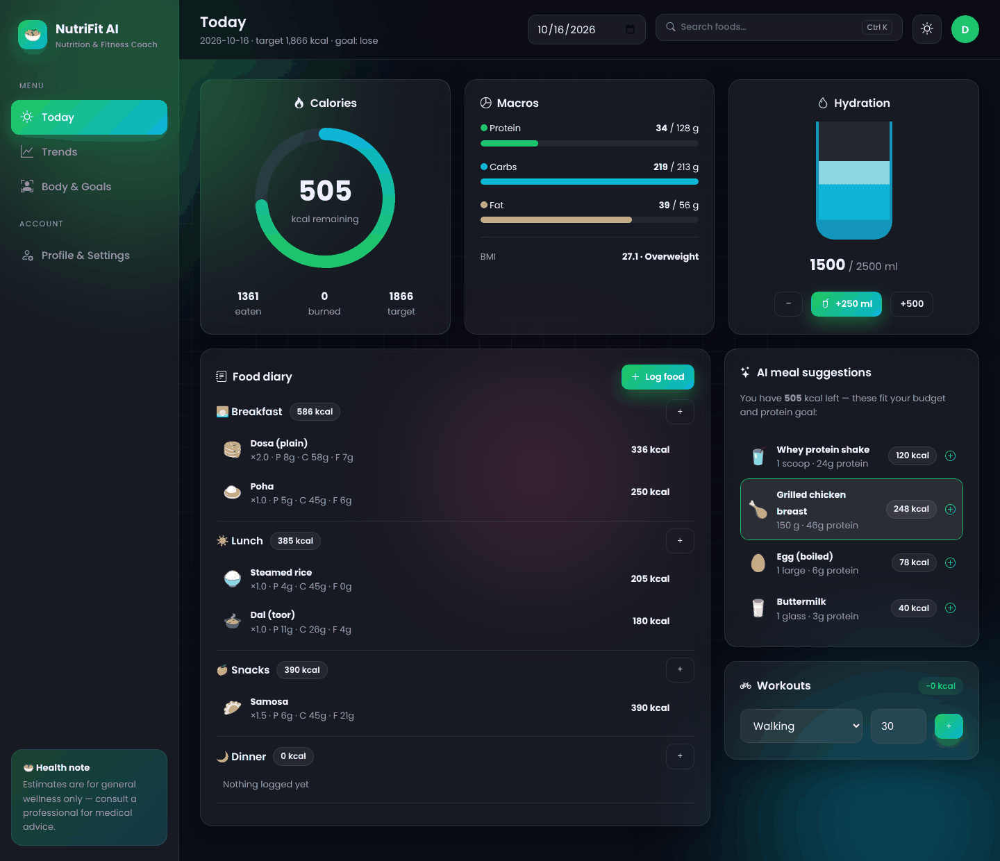
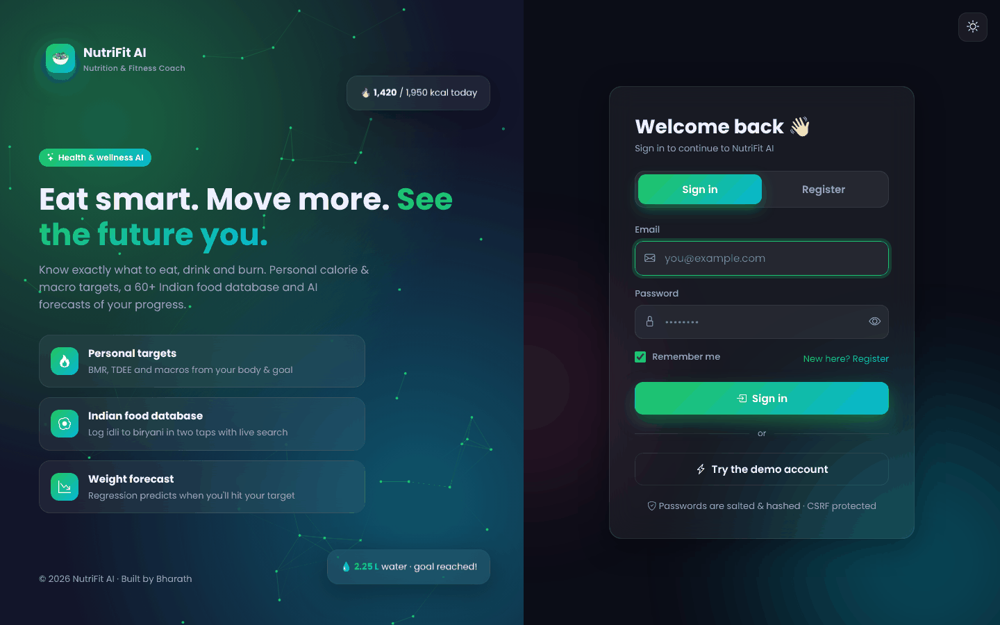
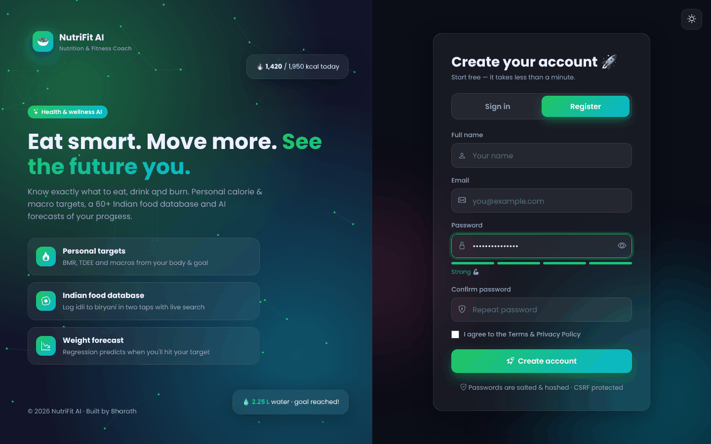
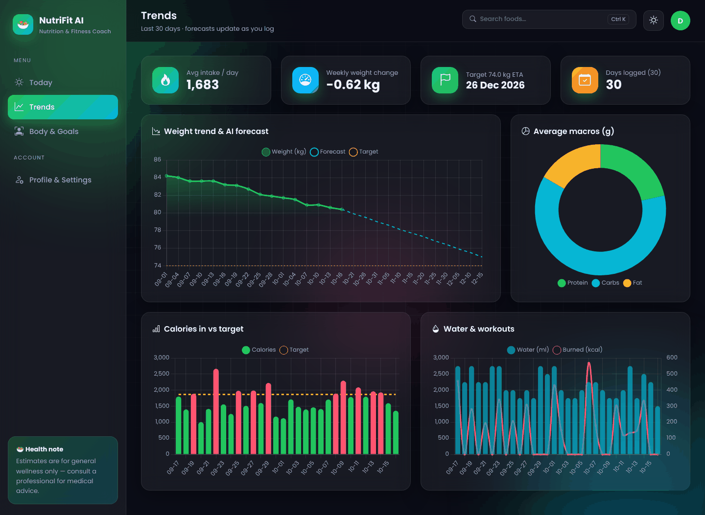
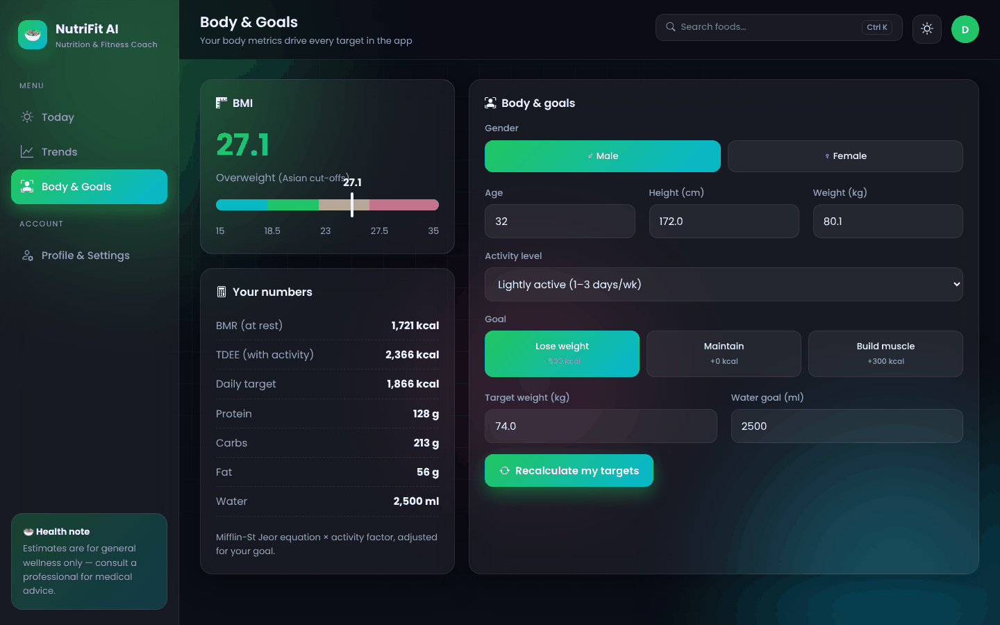
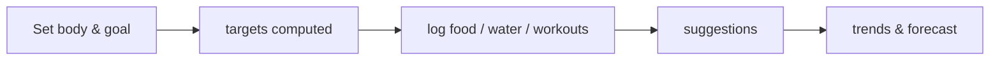

<div align="center">

# 🥗 NutriFit AI — Nutrition & Fitness Tracker

**Personal calorie & macro targets, a 60+ Indian food database, water & workout tracking and AI forecasts of your weight goal.**

    

`Health Tech · Data Science` · `Full-stack web app` · `Register / Login` · `Dark & light themes`

</div>

---



## ✨ Features

- **Personal targets** — BMR (Mifflin-St Jeor), TDEE, goal calories and protein/carb/fat macros
- **60+ foods** (idli to biryani) with live search, servings slider and meal-wise diary
- Animated **calorie ring**, macro bars and a **water glass** that fills with waves
- **MET-based workouts** that add calories back to your budget
- **AI meal suggestions** that fit remaining calories & protein needs
- **Weight forecast** (linear regression) with goal ETA, 30-day calorie / water / workout charts, Asian BMI scale

## 🎨 UI / UX highlights

- **Glassmorphism design system** with animated gradient blobs, grid overlay and per-project colour theme
- **Dark / light mode** toggle (remembered per browser) — every chart re-themes instantly
- **Split-screen auth pages** with an interactive particle network, floating cards and a typing "Try demo" button
- **Motion everywhere**: staggered fade-ups, count-up numbers, animated progress bars, ripple buttons, toast notifications, modals
- **Fully responsive** — collapsible sidebar on mobile, Ctrl + K search shortcut
- Works **offline**: Chart.js, Bootstrap Icons and Poppins font are bundled in `static/`

## 🔐 Authentication & security

- **Register / Login / Logout** with salted password hashing (Werkzeug PBKDF2)
- Live **password-strength meter**, show/hide password, "remember me" sessions (14 days)
- **CSRF protection** on every form and API call, brute-force lockout after 5 failed logins
- HttpOnly + SameSite cookies, security headers, per-user data isolation
- **Profile & settings**: edit name, avatar colour, change password, delete account

## 🖼️ Screenshots

| Sign in | Register |
|---|---|
|  |  |

| | |
|---|---|
|  |  |

## 🏗️ How it works



## 🧰 Tech stack

| Layer | Technology |
|---|---|
| Backend | Python 3, Flask, SQLite, numpy |
| Frontend | HTML5, CSS3 (custom glassmorphism design system), vanilla JavaScript |
| Charts & icons | Chart.js 4, Bootstrap Icons, Poppins (bundled locally) |
| Security | Werkzeug password hashing, CSRF tokens, secure sessions |

## 📁 Project structure

```
NUTRIFIT-AI-HEALTH-TRACKER/
├── app.py                 # Flask app: routes, business logic & JSON API
├── core.py                # Shared core: app factory, SQLite, auth, CSRF, profile
├── app.py                 # Routes, calculations, forecasts, API
├── foods.py               # Food & activity database
├── templates/             # Jinja2 pages (auth, base layout, feature pages)
├── static/                # style.css, main.js + bundled Chart.js, icons & fonts
├── assets/                # README screenshots
├── requirements.txt
└── LICENSE
```

## 🚀 Run it locally

```bash
git clone https://github.com/PreciousBharath/NUTRIFIT-AI-HEALTH-TRACKER.git
cd NUTRIFIT-AI-HEALTH-TRACKER
python -m venv venv && source venv/bin/activate      # Windows: venv\Scripts\activate
pip install -r requirements.txt
python app.py
```

Open **http://127.0.0.1:5000** → click **"Try the demo account"** (`demo@example.com` / `Demo@1234`) or register your own account.
The SQLite database is created automatically in `instance/` and seeded with realistic demo data.

> ⚕️ For general wellness education only — not medical advice.

## ⚙️ Production tips

- Set a strong `SECRET_KEY` environment variable and run behind **gunicorn** / **waitress** with HTTPS
- `DATABASE=/path/to/app.db` overrides the database location

## 👨‍💻 Author

**Bharath** — Software Developer · Project Engineer · Technical Trainer

[](https://linkedin.com/in/connectbharath)
[](https://itsbharathportfolio.netlify.app)
[](https://github.com/PreciousBharath)

⭐ If you like this project, please give it a star!

## 📄 License

Released under the [MIT License](LICENSE).
